# MELON — Dataset Information

## Overview

MELON is evaluated on five real-world spatial multi-omics datasets spanning different tissues, organisms, platforms, and modality combinations.

| Dataset | Tissue | Modalities |
|---|---|---|
| Mouse E13 Embryo | Whole mouse embryo | RNA + ATAC |
| Y7_T (ccRCC Tumor) | Human kidney tumor | RNA + SM (MALDI-MSI) |
| Mouse E15.5 Brain | Embryonic mouse brain | RNA + ATAC |
| Human Lymph Node | Human lymph node | RNA + Protein (ADT) |
| Human Hippocampus | Adult human brain | RNA + ATAC |

---

## 1. Mouse E13 Embryo (spatial-ATAC-RNA-seq)

This dataset profiles a whole E13 mouse embryo using spatial-ATAC-RNA-seq (Zhang et al., 2023), which co-profiles the epigenome and transcriptome via deterministic barcoding in tissue (DBiT-seq). Ground-truth annotations comprise embryonic tissue regions.

| H&E staining | Ground-truth annotation | Region legend |
|---|---|---|
| 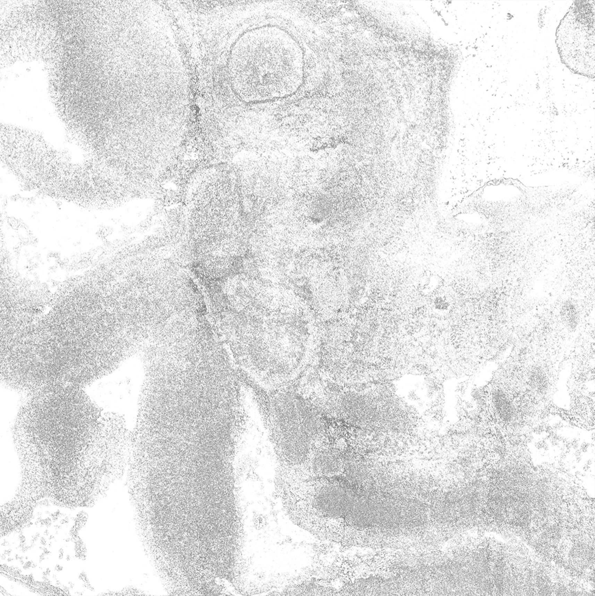 | 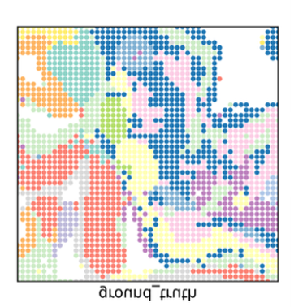 | 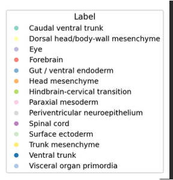 |

**Reference.** Zhang, D., Deng, Y. et al. [Spatial epigenome-transcriptome co-profiling of mammalian tissues](https://doi.org/10.1038/s41586-023-05795-1). *Nature*, 616(7955), 113--122, 2023.

---

## 2. Y7_T ccRCC Tumor Slice (Kidney)

Y7_T is a clear cell renal cell carcinoma (ccRCC) tumor slice from the kidney, profiled by spatial transcriptomics (RNA, gene expression) and spatial metabolomics (SM, MALDI-MSI, 1,299 m/z features). This dataset illustrates intra-tumoral heterogeneity, with both classical clear cell-like regions and a localized DCCD-like (distal convoluted and collecting duct-like) shift.

| H&E staining | Ground-truth annotation | Region legend |
|---|---|---|
| 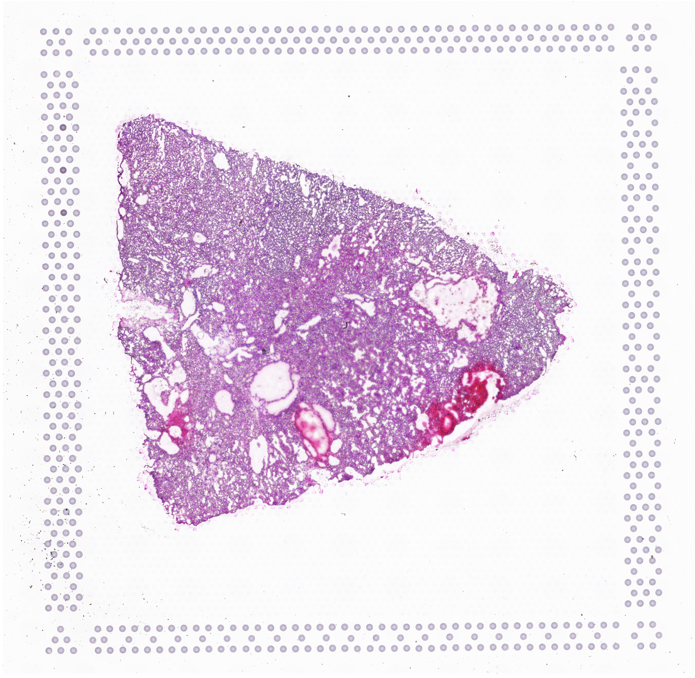 | 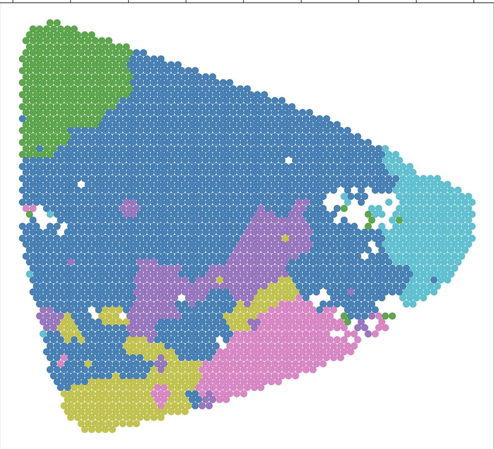 | 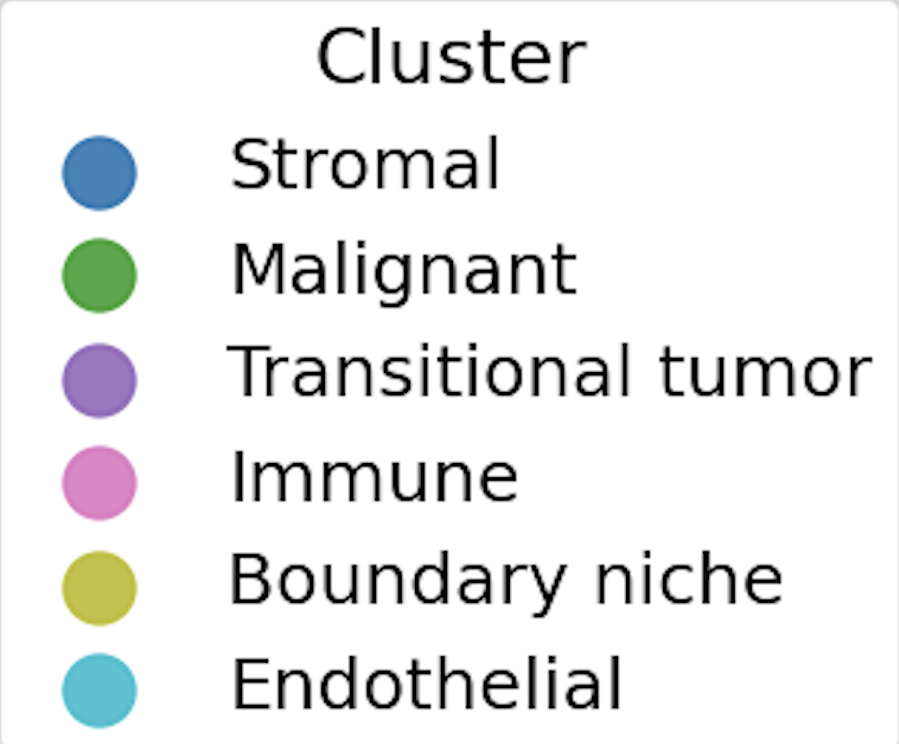 |

**Reference.** Hu, J., Wang, S.G., Hou, Y. et al. [Multi-omic profiling of clear cell renal cell carcinoma identifies metabolic reprogramming associated with disease progression](https://www.nature.com/articles/s41588-024-01662-5). *Nature Genetics*, 56, 442--457, 2024.

---

## 3. Mouse E15.5 Brain (MISAR-seq)

This dataset profiles the embryonic day 15.5 mouse brain using MISAR-seq (Microfluidic Indexing-based Spatial ATAC and RNA-seq; Zuo et al., 2023), which simultaneously captures chromatin accessibility and gene expression. Ground-truth annotations comprise manually labeled brain regions, validated against the Allen Mouse Brain Atlas.

| H&E staining | Ground-truth annotation | Region legend |
|---|---|---|
| 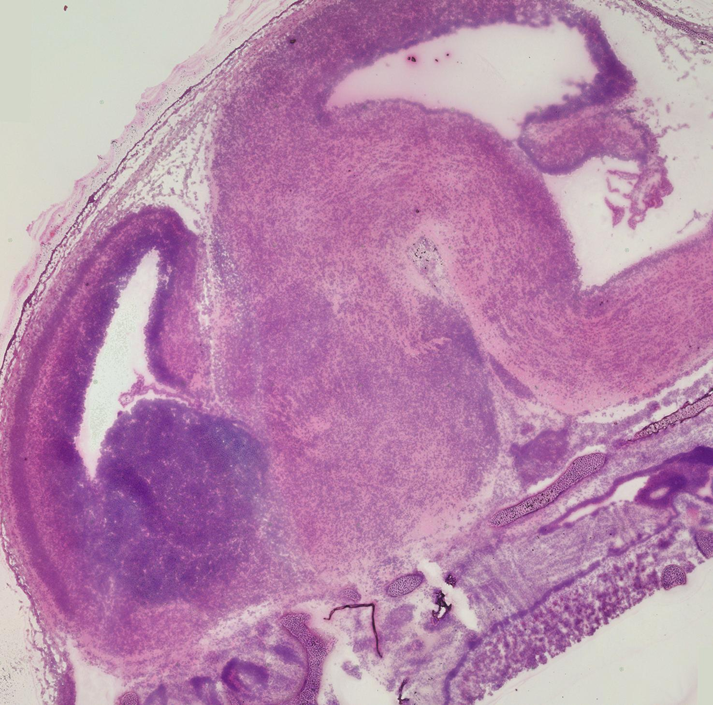 | 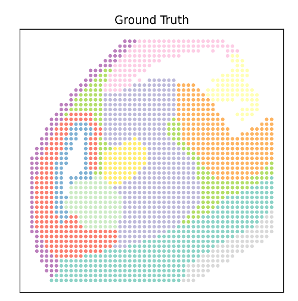 | 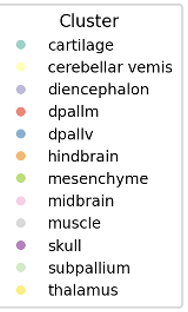 |

**Reference.** Zuo, C., Zhang, Z. et al. [Simultaneous profiling of spatial gene expression and chromatin accessibility during mouse brain development](https://doi.org/10.1038/s41592-023-01884-1). *Nature Methods*, 20(7), 1048--1057, 2023.

---

## 4. Human Lymph Node (10x Visium CytAssist)

Two sequential FFPE sections of human lymph node were profiled using the Visium CytAssist platform (10x Genomics; Long et al., 2024), capturing spatial gene expression (RNA) and spatial protein expression (ADT). Ground-truth annotations comprise manually labeled lymphoid compartments, annotated using high-resolution H&E images in Loupe Browser (10x Genomics).

| H&E staining | Ground-truth annotation | Region legend |
|---|---|---|
| 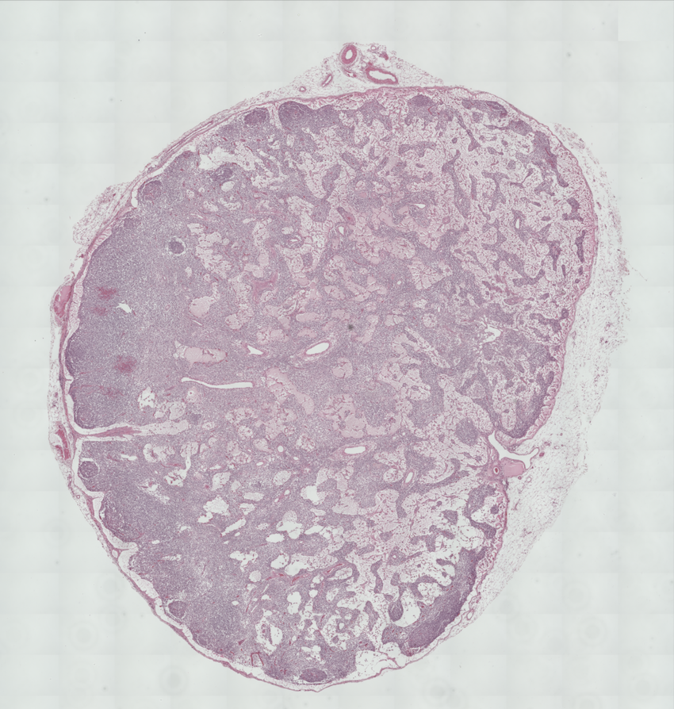 | 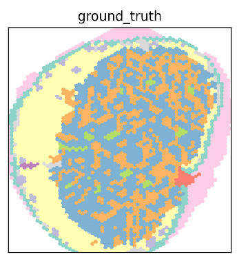 | 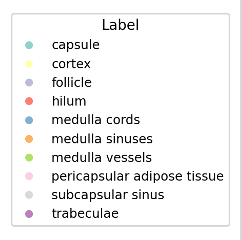 |

**Reference.** Long, Y., Ang, K.S. et al. [Deciphering spatial domains from spatial multi-omics with SpatialGlue](https://doi.org/10.1038/s41592-024-02316-4). *Nature Methods*, 21(9), 1658--1667, 2024.

---

## 5. Human Hippocampus (spatial-ATAC-RNA-seq)

This dataset profiles an adult human brain hippocampus section using spatial-ATAC-RNA-seq (Zhang et al., 2023), which co-profiles chromatin accessibility and gene expression via deterministic barcoding in tissue (DBiT-seq).

| Bright-field tissue image | Ground-truth annotation | Region legend |
|---|---|---|
| 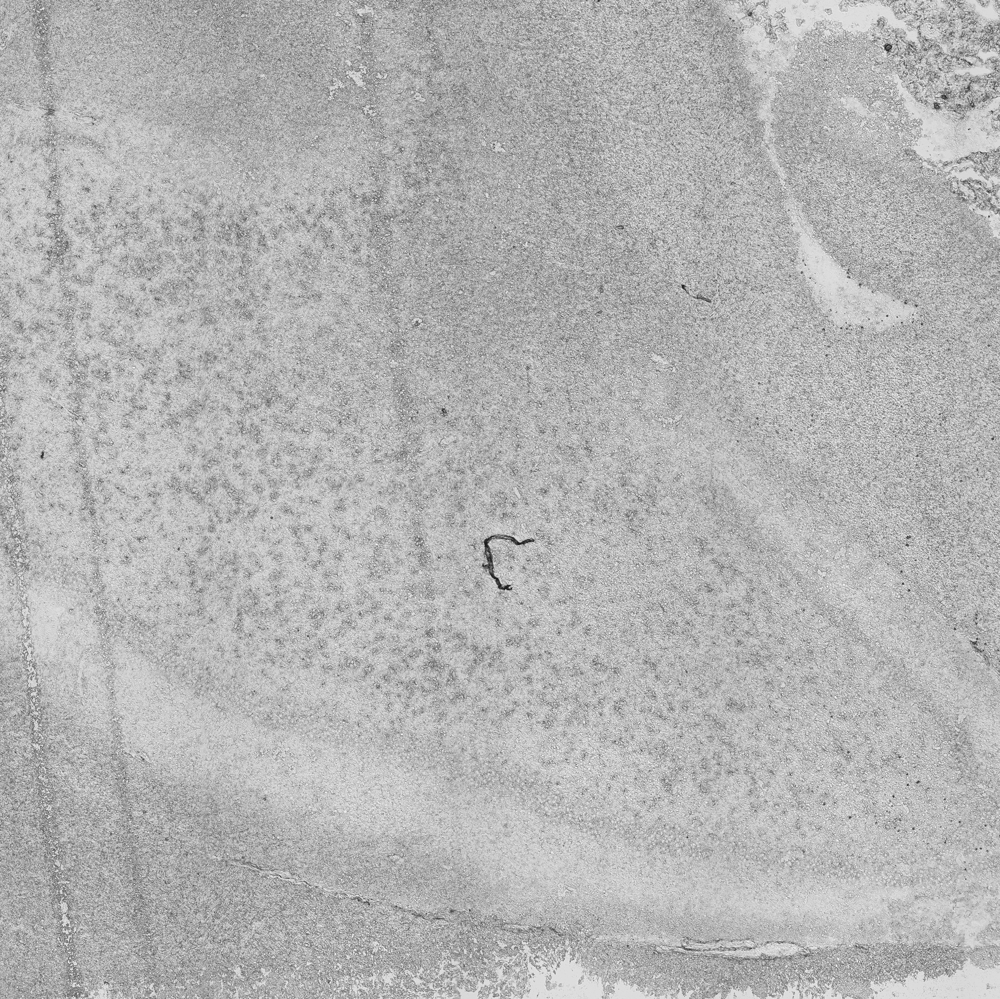 | 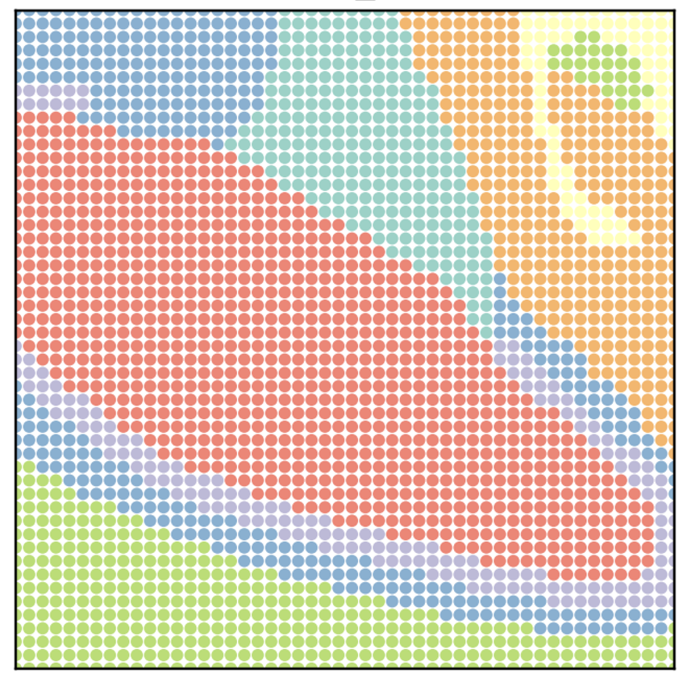 | 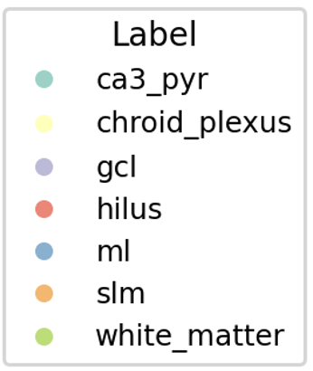 |

**Reference.** Zhang, D., Deng, Y. et al. [Spatial epigenome-transcriptome co-profiling of mammalian tissues](https://doi.org/10.1038/s41586-023-05795-1). *Nature*, 616(7955), 113--122, 2023.
